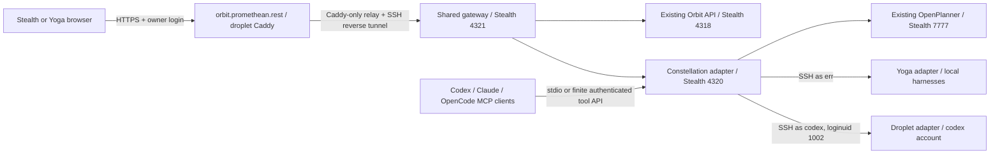

# Knoxx Constellation for Orbit

This is an optional, trusted, single-owner development integration. It provides
one shared Orbit workspace across browsers, a live three-host dashboard,
workspace/memory tools for Codex, Claude Code and OpenCode, and explicit new-worker
dispatch from the dashboard. Package version 0.3.1 and workspace schema 12 remain
unchanged. This does not replace Orbit's Hermes runtime.

## Ownership and placement



The droplet is the HTTPS ingress. The application and shared workspace store are
on Stealth. Stealth going offline interrupts the desktop; this is not a highly
available control plane or replicated Orbit SQLite store. Do not start writers
against copies of one live database. Other machines keep their local processes
and working directories; opening the desktop remotely does not move a shell.

Orbit's store remains layout/revision/checkpoint authority. Native harnesses own
their sessions and permission decisions. OpenPlanner owns its memory APIs.
Foresight remains the inventory/composition layer. Constellation job files are
private operational request/result records, not a replacement event kernel,
transcript archive or board engine. No Rheos board operation is implemented here.

## Components and configuration

- `bridge.py`: Python standard-library host probes, a loopback owner API, native
  CLI worker adapter and newline-delimited stdio MCP transport.
- `gateway.mjs`: Node/Orbit `ws`-based ingress with owner login, expiring HttpOnly
  SameSite cookies, origin checks, static production assets, HTTP/SSE/WebSocket
  forwarding and a finite remote tool endpoint.
- `dashboard.html`, `dashboard.js`, `dashboard.css`: reviewed dashboard UI. No
  third-party scripts or model calls are needed to load it.
- `src/constellation-session.ts`: optional ingress bootstrap. The gateway marks
  its HTML, synchronously binds the shared workspace identity, then supplies the
  owner's existing Orbit token through an authenticated no-store response. The
  token is held in browser memory, never URL parameters. Ordinary Orbit receives
  no shared binding and retains its existing manual host connection.
- The exact `/constellation/` page may be embedded only when that shared binding
  is active. Arbitrary same-origin pages and generated app frames retain their
  existing restrictions. The dashboard is trusted host code, not a generated
  plugin with an implicit privilege grant.

Set `ORBIT_CONSTELLATION_CONFIG` to an owner-only JSON file, or use
`~/.config/orbit/constellation.json`. It must have mode 0600. See
`config.example.json`; never commit filled credentials or private runtime data.
The central config contains the existing OpenPlanner key and OpenCode service
credential. Peer configs contain their own host configuration and a finite
controller tool credential, not the Orbit owner token or OpenPlanner key.

Node >=22.12 and Python >=3.10 are required. Use Orbit's installed `ws` package.
Dispatch uses each machine's existing authenticated CLI and provider policy. It
does not install models, set model overrides, disable approvals, or bypass
sandbox settings. Configure project IDs to existing explicit directories; a user
cannot submit an arbitrary working directory through the HTTP API.

## Agent to desktop

Register the stdio command with each harness using an absolute script path:

```sh
codex mcp add orbit-constellation -- python3 /path/to/bridge.py mcp
claude mcp add --scope user orbit-constellation -- python3 /path/to/bridge.py mcp
```

OpenCode's MCP entry uses `type: "local"`,
`command: ["python3", "/path/to/bridge.py", "mcp"]`, `enabled: true`.
If its config is generated, change the canonical configuration source, not the
generated JSON. Its authenticated `POST /mcp` endpoint can attach the adapter to
an already running server without terminating sessions. Existing Codex/Claude
clients may need a new session or MCP reconnect to discover a newly registered
server. Registration does not inject tools into an already running desktop chat.

The tools are:

| Tool | Authority |
| --- | --- |
| `orbit_fleet` | Current configured host probes and OpenPlanner observations |
| `orbit_workspace_read` | Shared workspace layout, no terminal/chat contents |
| `orbit_workspace_apply` | Existing Orbit validated operations with explicit base revision, operation ID and intent |
| `orbit_memory_search` | Bounded OpenPlanner full-text search |
| `orbit_projects` | Explicit project IDs and installed harnesses for one host |
| `orbit_jobs` | Public status and answers for Orbit-created workers |

The tool surface does not dispatch other agents. The dashboard's explicit owner
action owns new-worker dispatch. MCP clients on peers call only
`POST /constellation/api/tool` over authenticated HTTPS. That bearer credential
does not unlock the owner browser session or arbitrary Orbit APIs. Layout writes
are limited to the existing shared-workspace capability and its native checks.

## Desktop to agent

The owner chooses a host, harness, registered project and exact prompt, then
checks the explicit start confirmation. The resulting target is a **new CLI
worker**, not an existing Codex desktop chat, Claude conversation or OpenCode
session. Existing native sessions are visible as metadata; resuming/messaging
them is separate follow-up integration.

The adapter persists an operation UUID before launch. Exact retries return the
same record; reuse with changed input is refused. Remote requests are JSON on
SSH stdin, never interpolated shell fragments. Prompts are sent to CLI stdin.
Only public assistant text and native session identity are projected into the
dashboard; tool arguments, reasoning events and provider credentials are not.
Workers have a 15-minute runtime limit and a 10 MB output limit. A missing worker
identity or departed process becomes `outcome_unknown`; it is not replayed.
Native CLI sandbox/permission behavior still controls what a task can do.

This first version shows final answers in private job records. It does not
automatically ingest every worker transcript into OpenPlanner or claim that all
historical harness contexts share one memory partition. Explicit context
transfer, native session continuation, live token streaming, central hosting
independent of Stealth remain follow-up work. The Axxium consumer is implemented
as described below; its live issuer activation remains pending.

## Shared Axxium identity

The optional `axxium` configuration enables the same fixed issuer used by the
stack's existing shared-login contract:
`https://axxium.promethean.rest/oidc`. `openid-client` is pinned to 6.8.8, matching
the other prepared consumers. Axxium owns identity and root-session authority;
Orbit grants access only to explicit stable actor subjects in `allowed_subjects`.
Email matches and remote administrator claims never create a desktop owner.

The approved deployment binding is the owner's existing **Aaron Beavers** human
actor. The separate system administrator and any other valid Axxium account are
not granted this shared desktop. Actor IDs and private client credentials are
configured explicitly, not generated from a display name or an email address.

The login page offers **Sign in with Axxium**. The flow uses confidential-client
authorization code exchange with PKCE S256, browser-bound state, local replay rejection after successful login, a nonce,
RS256 signed-token verification, exact issuer/audience checks and current
client-scoped token introspection. Discovery endpoints must remain on the exact
configured authority origin; metadata cannot redirect client credentials to a
different service. Identity and access tokens remain in server memory, with an
opaque Secure/HttpOnly/SameSite=Lax browser cookie. Restarting the adapter requires
a new sign-in. Identity/access tokens never enter browser URLs or local storage;
the callback's short-lived authorization code is redeemed on the server.

Authenticated HTTP requests recheck the current grant without a positive cache.
Long-lived HTTP streams and WebSockets recheck at ten-second intervals, with a
five-second authority timeout. Expiration, revocation or an unavailable authority
ends the protected connection; it does not replay or cancel already accepted
native worker tasks. Logout removes the local desktop session and revokes the
access token. An unconfirmed authority revocation is reported separately from a
successful local sign-out. There is no global logout of unrelated product sessions.

| Route | Purpose |
| --- | --- |
| `GET /auth/axxium/start` | Begin the registered shared sign-in |
| `GET /auth/axxium/callback` | Exact registered browser callback |
| `POST /auth/axxium/logout` | Same-origin local logout and grant revocation |
| `GET /auth/axxium/status` | Content-free issuer configuration/availability |

At verification time on **2026-10-23**, the public issuer discovery returned 404,
the live authority's private OIDC config was absent, and Orbit's sign-in start
correctly returned 503. No real Axxium sign-in or client registration is claimed.
The live login entry is prepared; the central shared issuer must be activated
through its existing reviewed Axxium/Services lane before it can authenticate.
This integration does not deploy another identity authority or change the PDS's
discovery routes.

Private registration input is retained at
`.runtime/constellation/axxium-client-registration.json` on Stealth. It contains
the exact `orbit-desktop` client secret and callback
`https://orbit.promethean.rest/auth/axxium/callback` for the existing authority's
closed client schema. It is an additive client entry, **not** a replacement
authority config. Preserve existing clients, signing keys, cookie keys, storage
and active accounts during upstream activation. No credential appears in Git,
reports or the public status response.

`allow_owner_token` is an explicit migration switch. The current development
deployment leaves its original owner access under a separate disclosure while
the shared issuer is unavailable. Selecting Axxium never silently switches to
token authentication after a failed exchange. A successful Axxium callback clears
the legacy cookie. After live sign-in and revocation verification, set this switch
to `false` and restart only the shared gateway; all legacy owner cookies and
owner-token POSTs are then refused. Machine MCP credentials retain their finite
tool-only scope and do not unlock a browser session.

Run the protocol suite and the content-free live-entry probe:

```sh
node --test integrations/constellation/test-axxium-auth.mjs
node integrations/constellation/verify-axxium-login.mjs
```

The protocol suite uses the maintained library with actual RSA-signed fixture
tokens. It covers PKCE, nonce/state binding, one-use callbacks, expiration,
unapproved subjects, wrong signatures/issuers/audiences, current grants, endpoint
confinement, revocation, outages and logout. It does not substitute fixture success
for an authenticated human sign-in at the live issuer.

## Current deployment (observed 2026-10-23)

| Location | Installed/observed behavior |
| --- | --- |
| Stealth | Existing PM2 Orbit API/Vite and Hermes retained; new user services `orbit-constellation`, `orbit-shared-gateway`, `orbit-ingress-tunnel` |
| Yoga | Metadata adapter and all three MCP registrations; OpenCode attached live |
| Droplet | Caddy exact-host TLS, dedicated private relay, account-scoped probe; no CLI harness installed in codex's account |
| Shared workspace | Existing `a287d991-f478-44e9-825f-1b795d454176`; existing panes retained, Constellation window added through native revision/checkpoint API |

Ingress source templates are in this directory. Caddy's managed include is
`/srv/open-hax/state/caddy/managed/orbit-desktop.caddy`; it is preserved by the
existing Services-managed wildcard import. The socket listens at
`172.31.255.1:19084`, allows only Caddy's `172.31.255.2` source, and relays to the
loopback SSH listener at `127.0.0.1:19784`. The Stealth tunnel authenticates as
`knoxx-agent-codex`; no SSH agent forwarding is used. The public DNS A record is
DNS-only at `157.245.125.134`; Caddy owns exact-host TLS.

The source templates and this record are reviewable product-repository artifacts;
no Services promotion workflow or Foresight manifest registration is claimed.
This is a directly activated development desktop route, not a production-qualified
release. Review and adoption into the canonical Services controller remain separate.

Access [the desktop](https://orbit.promethean.rest/) or
[the dashboard](https://orbit.promethean.rest/constellation/) through the shared
login page. Axxium is the intended sign-in; while issuer activation is pending,
the existing Orbit owner token remains under the development-access disclosure.
It is read from the private runtime `session-token` file; no credential is
included in documentation, screenshots or committed config.

## Verification and recovery

Run `npm run check`, then these focused checks:

```sh
python3 -m unittest discover -s integrations/constellation -p 'test_bridge.py' -v
node --experimental-strip-types --test integrations/constellation/test-surface.mjs
node integrations/constellation/test-browser.mjs
```

The browser journey creates a **separate workspace**, uses the real Orbit API,
renders the actual dashboard iframe and performs real host probes and memory
search. It checks owner login, denied anonymous APIs, foreign origins, controller
token confinement, shared identity, revision acknowledgement and mobile overflow.
It never invokes a model or treats the owner's workspace as a test fixture.
This journey checks the explicit legacy migration configuration; the Axxium
protocol suite and live-entry probe are separate, and live human sign-in is
still unverified while the issuer is unavailable.
`ORBIT_TEST_BROWSER`, `ORBIT_TEST_SCRATCH` and `ORBIT_TEST_SCREENSHOT` can select
the browser, private test directory and screenshot location.

Changing the integration does not require restarting the existing Orbit/Hermes
services. Build into an isolated directory; place the verified output in a new
private adapter release directory, then update the gateway configuration. Keep
the previous directory and matching source for rollback. The initial deployment
has no replaced adapter release. Never overwrite an existing rollback bundle.

To withdraw external access, stop the **new** `orbit-ingress-tunnel` user service.
To withdraw the adapter, stop its two new user services after checking its job
records for accepted/running work. Preserve those records and reconcile unknown
submissions; stopping an adapter is not cancellation of a native worker. Existing
PM2 Orbit, Hermes and terminal processes are separately owned and stay in place.
Remove/revert the dashboard through Orbit's controller/checkpoint UI, never by
editing SQLite or old receipts. Remove MCP registrations through each harness's
configuration authority. Preserve the Caddy, relay and DNS source records before
any separate infrastructure removal. Layout checkpoints do not undo host effects.

The adapter is not included in the portable Hermes source archive. The small
optional frontend bootstrap **is** included and archive parity must be checked
after changing included source. Full-repository installation supplies this adapter.

SPDX-License-Identifier: GPL-3.0-or-later


## Proxx bot allowance and route observations

The existing dashboard can read an explicitly configured Proxx service. Add an
optional `proxx` object to the private 0600 constellation config with `url`,
`label` and `token`. Use a server-issued bot tenant key to restrict the view to
that key's budget and usage; an administrative token sees its administrative
scope. Only HTTPS or loopback HTTP is accepted. Redirects are refused. Tokens
stay in the trusted adapter and are never sent to the browser. Configuration
alone does not prove the bot uses this destination.

The adapter reads `/api/v1/paid-budgets` and a bounded sample of 200 recent
`/api/v1/request-logs` entries. Requests, prompts, arbitrary metadata and account
identifiers are omitted. The budget API must be deployed in Proxx before it can
return allowance data. Unsupported or failed API reads appear unavailable;
missing values never become zero spending. The view separates confirmed charges,
all unresolved holds, prior-period carried holds, and daily/monthly remaining
allowance. Both UTC limits apply together. Carried holds are a subset of the
held total, so the dashboard does not subtract them twice.

Recent actual-route costs and mean provider TTFT/decode TPS are a bounded
operational sample, not invoice reconciliation, end-to-end usable-answer latency,
model-quality evaluation, or proof that a specific bot originated every request.
Absent actual-upstream identity on historical rows remains visible through the
legacy requested model. Runtime activation and paired E4B/Lens evaluation require
separate receipts.

Pending Axxium sign-in state is sealed with AES-256-GCM in a Secure/HttpOnly
transaction cookie, bound to the desktop origin, issuer and confidential client.
Anonymous start requests allocate no pending-state map entry. The process retains
only short-lived approved callback digests and concurrent exchanges; Axxium
remains the authorization-code/PKCE authority. Tampering, expiration, another
adapter process, concurrent duplicate callbacks and replay after success are
refused. The replay cache admits a state only after signed ID-token validation,
explicit linked-subject authorization and current token introspection succeed.
Neither missing browser cookies nor invalid codes can fill this shared cache.
An unbound callback cannot consume a legitimate browser transaction. For rejected
token exchanges, the issuer remains responsible for single-use authorization
codes ([OAuth2 RFC6749 section4.1.2](https://www.rfc-editor.org/rfc/rfc6749.html#section-4.1.2));
the local cache does not pretend that an anonymous failure proves owner identity.
The protocol fixture enforces code single-use and verifies that a rejected
signed-token response cannot redeem the same code later. A process restart
invalidates pending sign-ins. Unsuccessful exchanges
never create a desktop session; authority availability remains a separate live
precondition. The protocol fixture proves these boundaries without real accounts.


An optional `model_evaluation_file` in the private config points to a bounded,
version1 aggregate report. The adapter forwards only known model/context rows,
finite nonnegative counters/timings/quality sums, provenance hash and bounded
scope/decision notes. It never forwards sample prompts, answers or tool results.
The dashboard labels this a recorded experiment, keeps failure counts visible,
and distinguishes first-usable timing from provider TTFT. Timing quantiles are
conditional on observed output, not promises for failed requests. The renderer
states that tool selection is not actual execution and author scoring is not
independent evaluation. Configuring or refreshing this surface never runs a model.

### Native review on the owner fork

The fork's `Constellation evidence review` workflow calls the same immutable
eta-mu/Muse/Agents revisions used by the Services release review. It binds the
pull request's exact head and supplies a side-effect-free diff-stat evidence
lane; the existing npm and browser workflows retain their own checks. The
reusable workflow defaults to the free OpenCode MiMo reviewer.

Native publication requires the existing `eta-mu-ai` GitHub App to be installed
on the owner fork, and `ETA_MU_APP_ID` / `ETA_MU_APP_PRIVATE_KEY` to be provisioned
through GitHub Actions secrets. No App credential belongs in this repository,
the portable source bundle, a screenshot, or chat. Installing the App or
provisioning its signing credential is a separate owner-authorized action;
adding the workflow does not grant that access. Missing credentials fail the
review job with an explicit operator instruction and supply no review credit.

GitHub disables inherited workflows on newly created forks until their owner
enables Actions. That fork-level activation is separate from the repository
Actions permission reported by the REST API. Keep the existing expensive
Asteria, technology and Workbench acceptance workflows under their original
manual/weekly activation controls.


### Shared terminal boundary

The gateway exposes only Orbit's terminal WebSocket endpoint. It serializes
client frames through a bounded queue and checks the terminal pane against
Orbit's current configured workspace snapshot before forwarding each frame.
Foreign panes, changed pane identities, non-terminal panes, removed panes,
binary frames and unavailable workspace authority fail closed. The owner token
remains with the existing authenticated session and local Orbit; this check
does not grant a new terminal or cross-workspace capability.

Failed owner-token attempts are throttled after credential comparison; a correct
owner token can still sign in after anonymous failures. Budget observations
project only dashboard fields, normalize absent usage to an empty object, and
preserve all returned budget and route rows. The Caddy template uses default
stream flushing so browser disconnects cancel upstream requests; SSE remains
immediately flushed by Caddy.

Run the native gateway boundary check with
`node --test integrations/constellation/test-gateway-boundaries.mjs`; it launches
only isolated fixture services, uses no model calls, and checks actual HTTP
login plus WebSocket frame forwarding.

Worker execution keeps its 900-second deadline active while delivering stdin and
waiting for process exit. Exceeding the output/deadline bounds or failing to exit
within ten seconds of stdout EOF kills and reaps the explicitly owned worker
process group. Existing desktop sessions are never part of that group.
